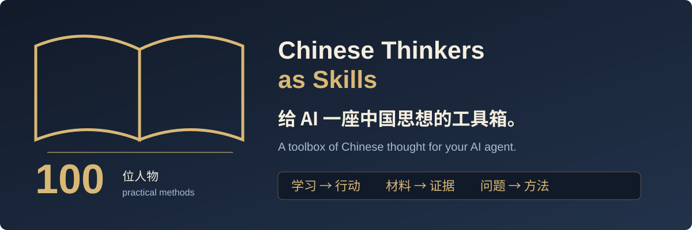

<div align="center">



# Chinese Thinkers as Skills

### A toolbox of Chinese thought for your AI agent.

**Learn with Confucius. Weigh options with Sun Tzu. Test hypotheses with Hu Shih. Map systems with Qian Xuesen.**

100 thinkers, scholars and practitioners. Individually installable Agent Skills with distinct workflows, source notes, examples and boundaries.

[](https://github.com/constantin2088/chinese-thinkers-skills/actions/workflows/validate.yml)
[](LICENSE)

[中文](README.md) · [Try one](#installation) · [Choose a task](#catalog) · [Sample tasks](docs/try-it.md)

</div>

## Installation

Start with one concrete problem. Wang Yangming's skill helps turn claimed knowledge into observed action:

```bash
npx skills add constantin2088/wang-yangming-action-skill
```

Select your client during installation, then try:

```text
Use the Wang Yangming skill: I know backups matter, but I have never tested a restore.
Distinguish missing knowledge, missing preparation, risks and conflicting goals.
Plan a 15-minute backup-and-restore task using a test file.
Return the knowledge-action gap, the real action, acceptance evidence and a next step if it fails.
Do not count a written plan as completed action.
```

The intended artifact is a small, checkable action record: what you claim to know, what you actually do, and the evidence that it worked. This is a fictional demonstration of the desired artifact, not a completed model benchmark.

See [installation and discovery](docs/installation.md) for scope and limitations. CLI discovery, installation and actual client execution are separate checks.

## Catalog

Choose by the problem first. Each thinker repository links back to this index and points to methods for similar tasks.

<!-- CATALOG:START -->
### Choose by the problem

| Your task | Start here |
|---|---|
| [Turn knowledge into demonstrated action.](docs/choose-a-skill.md#learning) | [Confucius](https://github.com/constantin2088/confucius-learning-skill) · [Wang Yangming](https://github.com/constantin2088/wang-yangming-action-skill) · [Su Shi](https://github.com/constantin2088/su-shi-understanding-skill) |
| [Check evidence, concepts and competing explanations.](docs/choose-a-skill.md#research) | [Lu Xun](https://github.com/constantin2088/lu-xun-selective-learning-skill) · [Mao Zedong](https://github.com/constantin2088/mao-zedong-investigation-skill) · [Hu Shi](https://github.com/constantin2088/hu-shi-hypotheses-skill) |
| [Compare options, constraints and system effects.](docs/choose-a-skill.md#decisions) | [Sun Tzu](https://github.com/constantin2088/sun-tzu-strategy-skill) · [Laozi](https://github.com/constantin2088/laozi-low-intervention-skill) · [Qian Xuesen](https://github.com/constantin2088/qian-xuesen-system-synthesis-skill) |
| [Examine incentives, responsibilities and coordination.](docs/choose-a-skill.md#organizations) | [Ye Maozhong](https://github.com/constantin2088/ye-maozhong-skill) · [Cai Yuanpei](https://github.com/constantin2088/cai-yuanpei-skill) · [Song Zhiping](https://github.com/constantin2088/song-zhiping-management-skill) |
| [Make expression precise and aesthetic judgments explicit.](docs/choose-a-skill.md#expression) | [Ye Shengtao](https://github.com/constantin2088/ye-shengtao-writing-skill) · [Zhu Guangqian](https://github.com/constantin2088/zhu-guangqian-aesthetics-skill) · [Zong Baihua](https://github.com/constantin2088/zong-baihua-artistic-skill) |
| [Reconsider assumptions, values and personal boundaries.](docs/choose-a-skill.md#reflection) | [Zhuangzi](https://github.com/constantin2088/zhuangzi-perspective-skill) · [Zhang Zai](https://github.com/constantin2088/zhang-zai-responsibility-skill) · [Feng Youlan](https://github.com/constantin2088/feng-youlan-reflection-skill) |

[Explore every skill by task](docs/choose-a-skill.md) · [Search the catalog](docs/installation.md#find-a-method)

### Start with a familiar task

| Thinker | What you can do |
|---|---|
| [Confucius](https://github.com/constantin2088/confucius-learning-skill) | Turn reading notes into actions and reliable commitments |
| [Sun Tzu](https://github.com/constantin2088/sun-tzu-strategy-skill) | Compare civilian project options and opportunity costs |
| [Laozi](https://github.com/constantin2088/laozi-low-intervention-skill) | Reduce unnecessary process and control costs |
| [Zhuangzi](https://github.com/constantin2088/zhuangzi-perspective-skill) | Compare perspectives beyond a single metric |
| [Wang Yangming](https://github.com/constantin2088/wang-yangming-action-skill) | Turn claimed knowledge into observed action |
| [Lu Xun](https://github.com/constantin2088/lu-xun-selective-learning-skill) | Distinguish useful practices from harmful baggage |
| [Mao Zedong](https://github.com/constantin2088/mao-zedong-investigation-skill) | Investigate first and keep a traceable fact ledger |
| [Qian Xuesen](https://github.com/constantin2088/qian-xuesen-system-synthesis-skill) | Combine expert views and data into testable plans |
| [Su Shi](https://github.com/constantin2088/su-shi-understanding-skill) | Test whether explanations transfer into practice |
| [Hu Shi](https://github.com/constantin2088/hu-shi-hypotheses-skill) | Turn slogans into falsifiable research questions |
| [Zhuge Liang](https://github.com/constantin2088/zhuge-liang-focus-skill) | Build a sustainable focus and learning plan |
| [Zeng Guofan](https://github.com/constantin2088/zeng-guofan-routines-skill) | Build sustainable routines with recovery mechanisms |

### Full catalog

<details>
<summary>All 100 thinkers</summary>

| Thinker | Focus | Repository | Status |
|---|---|---|---|
| **Liang Qichao** | Assess changing conditions and update capabilities | [liang-qichao-skill](https://github.com/constantin2088/liang-qichao-skill) | Published |
| **Ye Maozhong** | Find customer conflicts and design marketing experiments | [ye-maozhong-skill](https://github.com/constantin2088/ye-maozhong-skill) | Published |
| **Chen Yinke** | Cross-check historical sources and separate evidence levels | [chen-yinke-research-skill](https://github.com/constantin2088/chen-yinke-research-skill) | Published |
| **Cai Yuanpei** | Coordinate disagreement and plural perspectives | [cai-yuanpei-skill](https://github.com/constantin2088/cai-yuanpei-skill) | Published |
| **Song Zhiping** | Improve operating decisions and organizational efficiency | [song-zhiping-management-skill](https://github.com/constantin2088/song-zhiping-management-skill) | Published |
| **Cho-yun Hsu** | Trace structures and long-term system changes | [xu-zhuoyun-systems-skill](https://github.com/constantin2088/xu-zhuoyun-systems-skill) | Published |
| **Fei Xiaotong** | Plan field interviews and examine relationship contexts | [fei-xiaotong-fieldwork-skill](https://github.com/constantin2088/fei-xiaotong-fieldwork-skill) | Published |
| **Tao Xingzhi** | Learn through real tasks and independent transfer | [tao-xingzhi-learning-skill](https://github.com/constantin2088/tao-xingzhi-learning-skill) | Published |
| **Yan Fu** | Translate concepts without changing their claims | [yan-fu-translation-skill](https://github.com/constantin2088/yan-fu-translation-skill) | Published |
| **Huang Zongxi** | Review accountability and independent oversight | [huang-zongxi-governance-skill](https://github.com/constantin2088/huang-zongxi-governance-skill) | Published |
| **Gu Yanwu** | Research practical problems and evidence gaps | [gu-yanwu-practical-skill](https://github.com/constantin2088/gu-yanwu-practical-skill) | Published |
| **Zhang Zai** | Map shared responsibility and care burdens | [zhang-zai-responsibility-skill](https://github.com/constantin2088/zhang-zai-responsibility-skill) | Published |
| **Dai Zhen** | Distinguish concepts from actual human burdens | [dai-zhen-concepts-skill](https://github.com/constantin2088/dai-zhen-concepts-skill) | Published |
| **Wang Chong** | Challenge authority with logic and testable counterexamples | [wang-chong-skepticism-skill](https://github.com/constantin2088/wang-chong-skepticism-skill) | Published |
| **Zhang Xuecheng** | Explain documentary purpose and editorial choices | [zhang-xuecheng-documentation-skill](https://github.com/constantin2088/zhang-xuecheng-documentation-skill) | Published |
| **Fu Sinian** | Plan evidence collection and research tools | [fu-sinian-evidence-skill](https://github.com/constantin2088/fu-sinian-evidence-skill) | Published |
| **Qian Mu** | Explain institutions in their historical context | [qian-mu-context-skill](https://github.com/constantin2088/qian-mu-context-skill) | Published |
| **Liang Shuming** | Design gradual community cooperation experiments | [liang-shuming-community-skill](https://github.com/constantin2088/liang-shuming-community-skill) | Published |
| **Yan Yangchu** | Connect literacy, livelihood and civic participation | [yan-yangchu-education-skill](https://github.com/constantin2088/yan-yangchu-education-skill) | Published |
| **Ye Shengtao** | Revise writing to match what you really mean | [ye-shengtao-writing-skill](https://github.com/constantin2088/ye-shengtao-writing-skill) | Published |
| **Zhu Guangqian** | Ground aesthetic judgments in concrete observations | [zhu-guangqian-aesthetics-skill](https://github.com/constantin2088/zhu-guangqian-aesthetics-skill) | Published |
| **Zong Baihua** | Examine atmosphere, space and viewing rhythm | [zong-baihua-artistic-skill](https://github.com/constantin2088/zong-baihua-artistic-skill) | Published |
| **Liu Xie** | Organize purpose, material and narrative structure | [liu-xie-composition-skill](https://github.com/constantin2088/liu-xie-composition-skill) | Published |
| **Liu Zhiji** | Audit omissions and judgments in narratives | [liu-zhiji-narrative-skill](https://github.com/constantin2088/liu-zhiji-narrative-skill) | Published |
| **Shen Kuo** | Test observations against conditions and measurement errors | [shen-kuo-observation-skill](https://github.com/constantin2088/shen-kuo-observation-skill) | Published |
| **Song Yingxing** | Map materials, tools, processes and losses | [song-yingxing-process-skill](https://github.com/constantin2088/song-yingxing-process-skill) | Published |
| **Xu Guangqi** | Adapt outside knowledge through small local trials | [xu-guangqi-adaptation-skill](https://github.com/constantin2088/xu-guangqi-adaptation-skill) | Published |
| **Feng Youlan** | Reflect on motives and shared interests | [feng-youlan-reflection-skill](https://github.com/constantin2088/feng-youlan-reflection-skill) | Published |
| **Zheng Guanying** | Compare industrial capabilities and priorities | [zheng-guanying-commerce-skill](https://github.com/constantin2088/zheng-guanying-commerce-skill) | Published |
| **Yan Yuan** | Verify learning through independent performance | [yan-yuan-practice-skill](https://github.com/constantin2088/yan-yuan-practice-skill) | Published |
| **Wang Fuzhi** | Check the conditions behind historical analogies | [wang-fuzhi-context-skill](https://github.com/constantin2088/wang-fuzhi-context-skill) | Published |
| **Gong Zizhen** | Review talent diversity and narrow selection standards | [gong-zizhen-talent-skill](https://github.com/constantin2088/gong-zizhen-talent-skill) | Published |
| **Wei Yuan** | Compare outside practices before adopting them | [wei-yuan-benchmark-skill](https://github.com/constantin2088/wei-yuan-benchmark-skill) | Published |
| **Kang Youwei** | Pressure-test institutional visions and transition costs | [kang-youwei-utopia-skill](https://github.com/constantin2088/kang-youwei-utopia-skill) | Published |
| **Tan Sitong** | Examine barriers to voice, access and exit | [tan-sitong-barriers-skill](https://github.com/constantin2088/tan-sitong-barriers-skill) | Published |
| **Zhang Taiyan** | Trace terms across historical and translation contexts | [zhang-taiyan-terms-skill](https://github.com/constantin2088/zhang-taiyan-terms-skill) | Published |
| **Li Zhi** | Separate lived experience from borrowed rhetoric | [li-zhi-authenticity-skill](https://github.com/constantin2088/li-zhi-authenticity-skill) | Published |
| **Wang Anshi** | Review reform authority, burdens and objections | [wang-anshi-change-skill](https://github.com/constantin2088/wang-anshi-change-skill) | Published |
| **Sima Guang** | Control recurring spending and resource commitments | [sima-guang-restraint-skill](https://github.com/constantin2088/sima-guang-restraint-skill) | Published |
| **Su Xun** | Calculate cumulative costs of repeated concessions | [su-xun-concessions-skill](https://github.com/constantin2088/su-xun-concessions-skill) | Published |
| **Ouyang Xiu** | Review coalition interests and durable cooperation | [ouyang-xiu-coalitions-skill](https://github.com/constantin2088/ouyang-xiu-coalitions-skill) | Published |
| **Han Yu** | Match questions with mentors and test transfer | [han-yu-mentorship-skill](https://github.com/constantin2088/han-yu-mentorship-skill) | Published |
| **Liu Zongyuan** | Reduce harmful intervention while preserving support | [liu-zongyuan-intervention-skill](https://github.com/constantin2088/liu-zongyuan-intervention-skill) | Published |
| **Ji Kang** | State role boundaries and practical alternatives | [ji-kang-boundaries-skill](https://github.com/constantin2088/ji-kang-boundaries-skill) | Published |
| **Ruan Ji** | Reconsider inherited social roles and evaluation scripts | [ruan-ji-conformity-skill](https://github.com/constantin2088/ruan-ji-conformity-skill) | Published |
| **Ge Hong** | Compare diverse knowledge without erasing disagreement | [ge-hong-breadth-skill](https://github.com/constantin2088/ge-hong-breadth-skill) | Published |
| **Chen Liang** | Distinguish nominal resources from usable capability | [chen-liang-capability-skill](https://github.com/constantin2088/chen-liang-capability-skill) | Published |
| **Hong Liangji** | Compare demand growth, supply and distribution gaps | [hong-liangji-resources-skill](https://github.com/constantin2088/hong-liangji-resources-skill) | Published |
| **Li Yu** | Match designs to real use and physical constraints | [li-yu-usability-skill](https://github.com/constantin2088/li-yu-usability-skill) | Published |
| **Yuan Mei** | Develop style from concrete feeling and subject matter | [yuan-mei-expression-skill](https://github.com/constantin2088/yuan-mei-expression-skill) | Published |
| **Confucius** | Turn reading notes into actions and reliable commitments | [confucius-learning-skill](https://github.com/constantin2088/confucius-learning-skill) | Published |
| **Mencius** | Translate values into choices with clear boundaries | [mencius-values-skill](https://github.com/constantin2088/mencius-values-skill) | Published |
| **Xunzi** | Design practice environments that sustain learning | [xunzi-deliberate-learning-skill](https://github.com/constantin2088/xunzi-deliberate-learning-skill) | Published |
| **Laozi** | Reduce unnecessary process and control costs | [laozi-low-intervention-skill](https://github.com/constantin2088/laozi-low-intervention-skill) | Published |
| **Zhuangzi** | Compare perspectives beyond a single metric | [zhuangzi-perspective-skill](https://github.com/constantin2088/zhuangzi-perspective-skill) | Published |
| **Mozi** | Evaluate people through capability and resource effects | [mozi-merit-skill](https://github.com/constantin2088/mozi-merit-skill) | Published |
| **Han Fei** | Audit incentives, gaming and divided responsibility | [han-fei-incentives-skill](https://github.com/constantin2088/han-fei-incentives-skill) | Published |
| **Sun Tzu** | Compare civilian project options and opportunity costs | [sun-tzu-strategy-skill](https://github.com/constantin2088/sun-tzu-strategy-skill) | Published |
| **Sun Bin** | Reallocate resources according to actual conditions | [sun-bin-matching-skill](https://github.com/constantin2088/sun-bin-matching-skill) | Published |
| **Guan Zhong** | Repair operating foundations before changing incentives | [guan-zhong-foundations-skill](https://github.com/constantin2088/guan-zhong-foundations-skill) | Published |
| **Shang Yang** | Review reform costs and legitimate objections | [shang-yang-reform-skill](https://github.com/constantin2088/shang-yang-reform-skill) | Published |
| **Guiguzi** | Listen for evidence before persuading or negotiating | [guiguzi-listening-skill](https://github.com/constantin2088/guiguzi-listening-skill) | Published |
| **Dong Zhongshu** | Trace failures to governance responsibilities | [dong-zhongshu-accountability-skill](https://github.com/constantin2088/dong-zhongshu-accountability-skill) | Published |
| **Jia Yi** | Reserve resources for unexpected demand | [jia-yi-reserves-skill](https://github.com/constantin2088/jia-yi-reserves-skill) | Published |
| **Sima Qian** | Write history with explicit evidence and uncertainty | [sima-qian-history-skill](https://github.com/constantin2088/sima-qian-history-skill) | Published |
| **Ban Gu** | Make classification boundaries visible | [ban-gu-categories-skill](https://github.com/constantin2088/ban-gu-categories-skill) | Published |
| **Zhuge Liang** | Build a sustainable focus and learning plan | [zhuge-liang-focus-skill](https://github.com/constantin2088/zhuge-liang-focus-skill) | Published |
| **Liu Yuxi** | Separate fixed conditions from room for action | [liu-yuxi-agency-skill](https://github.com/constantin2088/liu-yuxi-agency-skill) | Published |
| **Bai Juyi** | Make writing respond to a concrete problem | [bai-juyi-purpose-skill](https://github.com/constantin2088/bai-juyi-purpose-skill) | Published |
| **Su Shi** | Test whether explanations transfer into practice | [su-shi-understanding-skill](https://github.com/constantin2088/su-shi-understanding-skill) | Published |
| **Zhu Xi** | Read passages carefully and check interpretations | [zhu-xi-close-reading-skill](https://github.com/constantin2088/zhu-xi-close-reading-skill) | Published |
| **Lu Jiuyuan** | Examine the motives behind stated goals | [lu-jiuyuan-intentions-skill](https://github.com/constantin2088/lu-jiuyuan-intentions-skill) | Published |
| **Wang Yangming** | Turn claimed knowledge into observed action | [wang-yangming-action-skill](https://github.com/constantin2088/wang-yangming-action-skill) | Published |
| **Zeng Guofan** | Build sustainable routines with recovery mechanisms | [zeng-guofan-routines-skill](https://github.com/constantin2088/zeng-guofan-routines-skill) | Published |
| **Hui Shi** | Find shifting definitions and scales in disputes | [hui-shi-definitions-skill](https://github.com/constantin2088/hui-shi-definitions-skill) | Published |
| **Zhang Zhidong** | Separate enduring purposes from imported methods | [zhang-zhidong-adaptation-skill](https://github.com/constantin2088/zhang-zhidong-adaptation-skill) | Published |
| **Hu Shi** | Turn slogans into falsifiable research questions | [hu-shi-hypotheses-skill](https://github.com/constantin2088/hu-shi-hypotheses-skill) | Published |
| **Lu Xun** | Distinguish useful practices from harmful baggage | [lu-xun-selective-learning-skill](https://github.com/constantin2088/lu-xun-selective-learning-skill) | Published |
| **Chen Duxiu** | Test independent claims for practical validity | [chen-duxiu-independent-thinking-skill](https://github.com/constantin2088/chen-duxiu-independent-thinking-skill) | Published |
| **Li Dazhao** | Connect future aspirations with present actions | [li-dazhao-present-action-skill](https://github.com/constantin2088/li-dazhao-present-action-skill) | Published |
| **Mao Zedong** | Investigate first and keep a traceable fact ledger | [mao-zedong-investigation-skill](https://github.com/constantin2088/mao-zedong-investigation-skill) | Published |
| **Zhou Enlai** | Clarify public duties and private interests | [zhou-enlai-public-duty-skill](https://github.com/constantin2088/zhou-enlai-public-duty-skill) | Published |
| **Deng Xiaoping** | Test small changes against evidence before expanding | [deng-xiaoping-fact-based-pilots-skill](https://github.com/constantin2088/deng-xiaoping-fact-based-pilots-skill) | Published |
| **Sun Yat Sen** | Separate preparation, knowledge and execution | [sun-yat-sen-preparation-skill](https://github.com/constantin2088/sun-yat-sen-preparation-skill) | Published |
| **Huang Yanpei** | Connect learning to actual vocational tasks | [huang-yanpei-vocational-fit-skill](https://github.com/constantin2088/huang-yanpei-vocational-fit-skill) | Published |
| **Wang Guowei** | Ground aesthetic scenes in textual details | [wang-guowei-aesthetic-scenes-skill](https://github.com/constantin2088/wang-guowei-aesthetic-scenes-skill) | Published |
| **Lin Yutang** | Use humor without losing kindness or respect | [lin-yutang-kind-humor-skill](https://github.com/constantin2088/lin-yutang-kind-humor-skill) | Published |
| **Qian Zhongshu** | Establish comparability before comparing texts | [qian-zhongshu-comparative-reading-skill](https://github.com/constantin2088/qian-zhongshu-comparative-reading-skill) | Published |
| **Yang Jiang** | Write restrained narratives with facts and warmth | [yang-jiang-restrained-narrative-skill](https://github.com/constantin2088/yang-jiang-restrained-narrative-skill) | Published |
| **Chen Heqin** | Design learning through life-based activities | [chen-heqin-active-curriculum-skill](https://github.com/constantin2088/chen-heqin-active-curriculum-skill) | Published |
| **Zhang Boling** | Connect service purposes with capability evidence | [zhang-boling-service-capability-skill](https://github.com/constantin2088/zhang-boling-service-capability-skill) | Published |
| **Xiong Shili** | Examine how principles appear in actual practice | [xiong-shili-principles-in-use-skill](https://github.com/constantin2088/xiong-shili-principles-in-use-skill) | Published |
| **Mou Zongsan** | Separate value judgments from specialist knowledge | [mou-zongsan-judgment-boundaries-skill](https://github.com/constantin2088/mou-zongsan-judgment-boundaries-skill) | Published |
| **Tang Junyi** | Preserve multiple perspectives in cultural dialogue | [tang-junyi-cultural-dialogue-skill](https://github.com/constantin2088/tang-junyi-cultural-dialogue-skill) | Published |
| **Ji Xianlin** | Understand materials before cross-cultural borrowing | [ji-xianlin-cultural-learning-skill](https://github.com/constantin2088/ji-xianlin-cultural-learning-skill) | Published |
| **Nan Huaijin** | Check classical commentary against its sources | [nan-huaijin-classics-check-skill](https://github.com/constantin2088/nan-huaijin-classics-check-skill) | Published |
| **Qian Xuesen** | Combine expert views and data into testable plans | [qian-xuesen-system-synthesis-skill](https://github.com/constantin2088/qian-xuesen-system-synthesis-skill) | Published |
| **Ma Yinchu** | Compare population and resources on consistent scales | [ma-yinchu-resource-scenarios-skill](https://github.com/constantin2088/ma-yinchu-resource-scenarios-skill) | Published |
| **Wu Jinglian** | Review competition rules before judging efficiency | [wu-jinglian-competition-rules-skill](https://github.com/constantin2088/wu-jinglian-competition-rules-skill) | Published |
| **Li Zehou** | Explain aesthetic experience through historical conditions | [li-zehou-aesthetic-context-skill](https://github.com/constantin2088/li-zehou-aesthetic-context-skill) | Published |

</details>

<details>
<summary>Individual install commands</summary>


Only published entries are installable.

```bash
npx skills add constantin2088/liang-qichao-skill
npx skills add constantin2088/ye-maozhong-skill
npx skills add constantin2088/chen-yinke-research-skill
npx skills add constantin2088/cai-yuanpei-skill
npx skills add constantin2088/song-zhiping-management-skill
npx skills add constantin2088/xu-zhuoyun-systems-skill
npx skills add constantin2088/fei-xiaotong-fieldwork-skill
npx skills add constantin2088/tao-xingzhi-learning-skill
npx skills add constantin2088/yan-fu-translation-skill
npx skills add constantin2088/huang-zongxi-governance-skill
npx skills add constantin2088/gu-yanwu-practical-skill
npx skills add constantin2088/zhang-zai-responsibility-skill
npx skills add constantin2088/dai-zhen-concepts-skill
npx skills add constantin2088/wang-chong-skepticism-skill
npx skills add constantin2088/zhang-xuecheng-documentation-skill
npx skills add constantin2088/fu-sinian-evidence-skill
npx skills add constantin2088/qian-mu-context-skill
npx skills add constantin2088/liang-shuming-community-skill
npx skills add constantin2088/yan-yangchu-education-skill
npx skills add constantin2088/ye-shengtao-writing-skill
npx skills add constantin2088/zhu-guangqian-aesthetics-skill
npx skills add constantin2088/zong-baihua-artistic-skill
npx skills add constantin2088/liu-xie-composition-skill
npx skills add constantin2088/liu-zhiji-narrative-skill
npx skills add constantin2088/shen-kuo-observation-skill
npx skills add constantin2088/song-yingxing-process-skill
npx skills add constantin2088/xu-guangqi-adaptation-skill
npx skills add constantin2088/feng-youlan-reflection-skill
npx skills add constantin2088/zheng-guanying-commerce-skill
npx skills add constantin2088/yan-yuan-practice-skill
npx skills add constantin2088/wang-fuzhi-context-skill
npx skills add constantin2088/gong-zizhen-talent-skill
npx skills add constantin2088/wei-yuan-benchmark-skill
npx skills add constantin2088/kang-youwei-utopia-skill
npx skills add constantin2088/tan-sitong-barriers-skill
npx skills add constantin2088/zhang-taiyan-terms-skill
npx skills add constantin2088/li-zhi-authenticity-skill
npx skills add constantin2088/wang-anshi-change-skill
npx skills add constantin2088/sima-guang-restraint-skill
npx skills add constantin2088/su-xun-concessions-skill
npx skills add constantin2088/ouyang-xiu-coalitions-skill
npx skills add constantin2088/han-yu-mentorship-skill
npx skills add constantin2088/liu-zongyuan-intervention-skill
npx skills add constantin2088/ji-kang-boundaries-skill
npx skills add constantin2088/ruan-ji-conformity-skill
npx skills add constantin2088/ge-hong-breadth-skill
npx skills add constantin2088/chen-liang-capability-skill
npx skills add constantin2088/hong-liangji-resources-skill
npx skills add constantin2088/li-yu-usability-skill
npx skills add constantin2088/yuan-mei-expression-skill
npx skills add constantin2088/confucius-learning-skill
npx skills add constantin2088/mencius-values-skill
npx skills add constantin2088/xunzi-deliberate-learning-skill
npx skills add constantin2088/laozi-low-intervention-skill
npx skills add constantin2088/zhuangzi-perspective-skill
npx skills add constantin2088/mozi-merit-skill
npx skills add constantin2088/han-fei-incentives-skill
npx skills add constantin2088/sun-tzu-strategy-skill
npx skills add constantin2088/sun-bin-matching-skill
npx skills add constantin2088/guan-zhong-foundations-skill
npx skills add constantin2088/shang-yang-reform-skill
npx skills add constantin2088/guiguzi-listening-skill
npx skills add constantin2088/dong-zhongshu-accountability-skill
npx skills add constantin2088/jia-yi-reserves-skill
npx skills add constantin2088/sima-qian-history-skill
npx skills add constantin2088/ban-gu-categories-skill
npx skills add constantin2088/zhuge-liang-focus-skill
npx skills add constantin2088/liu-yuxi-agency-skill
npx skills add constantin2088/bai-juyi-purpose-skill
npx skills add constantin2088/su-shi-understanding-skill
npx skills add constantin2088/zhu-xi-close-reading-skill
npx skills add constantin2088/lu-jiuyuan-intentions-skill
npx skills add constantin2088/wang-yangming-action-skill
npx skills add constantin2088/zeng-guofan-routines-skill
npx skills add constantin2088/hui-shi-definitions-skill
npx skills add constantin2088/zhang-zhidong-adaptation-skill
npx skills add constantin2088/hu-shi-hypotheses-skill
npx skills add constantin2088/lu-xun-selective-learning-skill
npx skills add constantin2088/chen-duxiu-independent-thinking-skill
npx skills add constantin2088/li-dazhao-present-action-skill
npx skills add constantin2088/mao-zedong-investigation-skill
npx skills add constantin2088/zhou-enlai-public-duty-skill
npx skills add constantin2088/deng-xiaoping-fact-based-pilots-skill
npx skills add constantin2088/sun-yat-sen-preparation-skill
npx skills add constantin2088/huang-yanpei-vocational-fit-skill
npx skills add constantin2088/wang-guowei-aesthetic-scenes-skill
npx skills add constantin2088/lin-yutang-kind-humor-skill
npx skills add constantin2088/qian-zhongshu-comparative-reading-skill
npx skills add constantin2088/yang-jiang-restrained-narrative-skill
npx skills add constantin2088/chen-heqin-active-curriculum-skill
npx skills add constantin2088/zhang-boling-service-capability-skill
npx skills add constantin2088/xiong-shili-principles-in-use-skill
npx skills add constantin2088/mou-zongsan-judgment-boundaries-skill
npx skills add constantin2088/tang-junyi-cultural-dialogue-skill
npx skills add constantin2088/ji-xianlin-cultural-learning-skill
npx skills add constantin2088/nan-huaijin-classics-check-skill
npx skills add constantin2088/qian-xuesen-system-synthesis-skill
npx skills add constantin2088/ma-yinchu-resource-scenarios-skill
npx skills add constantin2088/wu-jinglian-competition-rules-skill
npx skills add constantin2088/li-zehou-aesthetic-context-skill
```

</details>
<!-- CATALOG:END -->

## What makes these methods useful

- **Concrete artifacts:** ordered workflows, worksheets and examples that make the next step visible.
- **Traceable evidence:** source notes identify passages, translations, research commentary and the scope actually reviewed.
- **Distinct methods:** action acceptance, hypothesis testing and historical cross-checking produce different reasoning artifacts.
- **Explicit limits:** modern workflows are project interpretations; historical figures are not presented as authorities on events they never experienced.

Skill instructions and worked examples are primarily in Chinese. The catalog provides English task descriptions for discovery; English client behavior has not been separately evaluated.

## Current status

**100 public thinker Skills. Direct repository installation, without GitHub Releases. Further character expansion is paused while we improve real use and feedback.**

The latest 50 additions have 550 passing local deterministic unit tests and 500 defined model behavior cases. **Independent-client model behavior evaluations have not been executed.** CI and installation discovery do not establish model quality or long-term results; older cases are reviewed separately.

[Quality standard](QUALITY_STANDARD.md) · [Roadmap](ROADMAP.md) · [Selection and source scope](docs/selection-famous-fifty-2026-10-10.md).

## One catalog, connected repositories

[catalog/skills.json](catalog/skills.json) supplies publication status, task descriptions, six discovery paths and recommendation order. Generated README blocks preserve each repository's original text. Each thinker has a series mark, backlink, three related methods and a collapsed complete list. About metadata is synchronized during publishing; the [developer template](https://github.com/constantin2088/thinkers-skill-template) inherits the association.

[Automation details](docs/series-automation.md).

## Help improve a method

If a method is useful, ⭐ star the index so you can find it again. A concrete failure report is even more useful: [share a task](https://github.com/constantin2088/chinese-thinkers-skills/issues/new?template=task-feedback.yml) or [correct a source](https://github.com/constantin2088/chinese-thinkers-skills/issues/new?template=quality-bug.yml). Include the Skill, client, input, output and failure point; remove private data first. New thinker proposals remain a backlog during this quality phase.

[Contributing](CONTRIBUTING.md) · [Code of conduct](CODE_OF_CONDUCT.md) · [Security](SECURITY.md).

A [1280×640 share card](assets/social-preview.png) is available when you introduce the collection to someone else. Link to this index so they can choose by task.

Original project material is [MIT licensed](LICENSE); linked third-party works retain their own rights. Independent project, with no endorsement claimed from historical figures, families or institutions. Maintainer: [@constantin2088](https://github.com/constantin2088).
